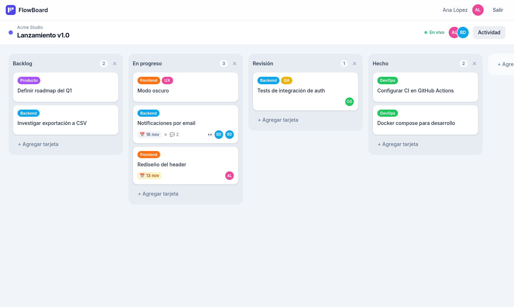
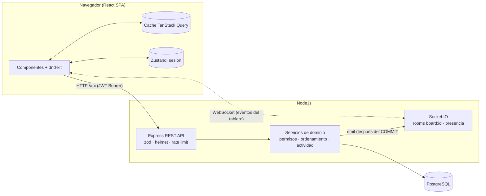
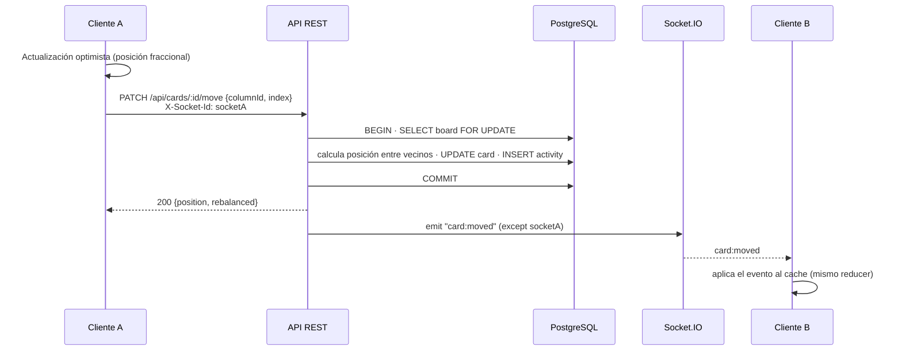
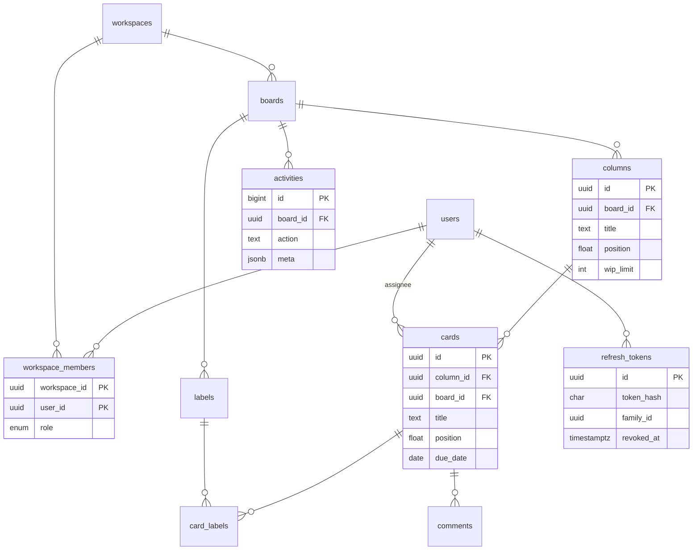
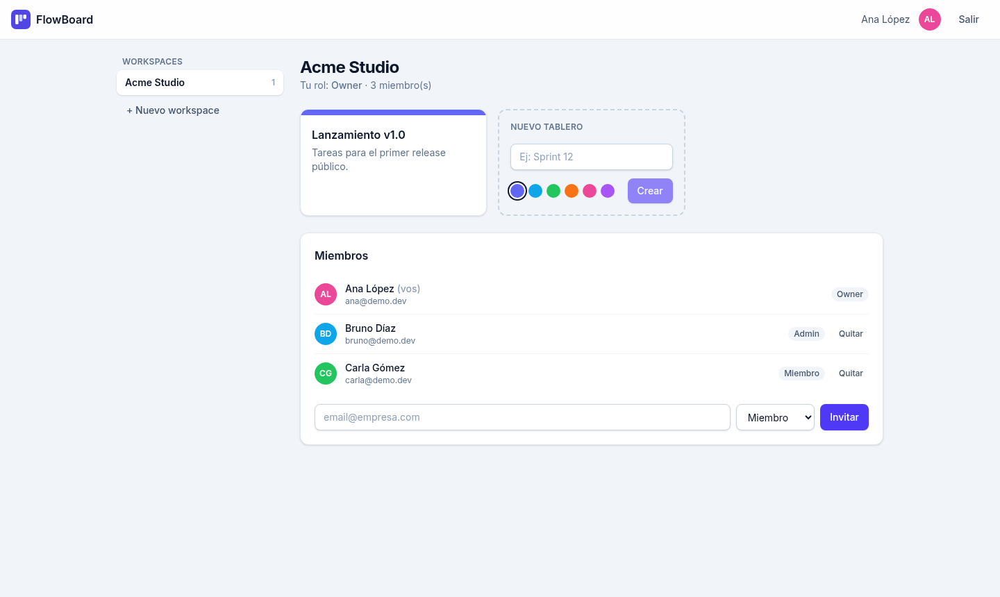
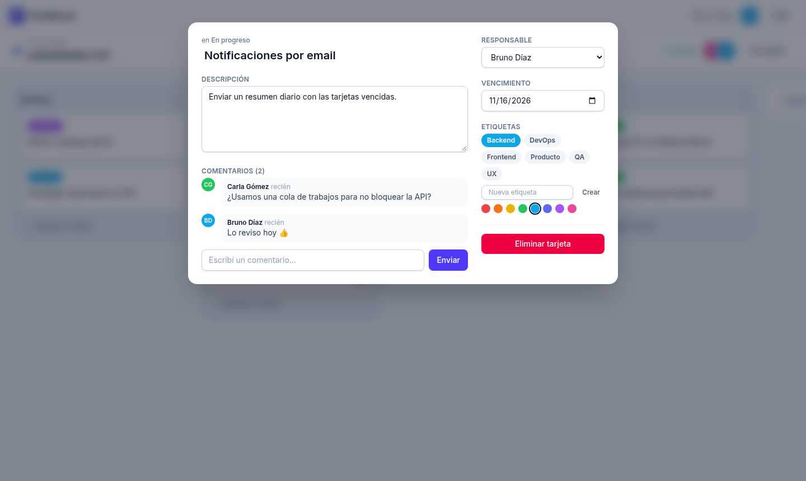
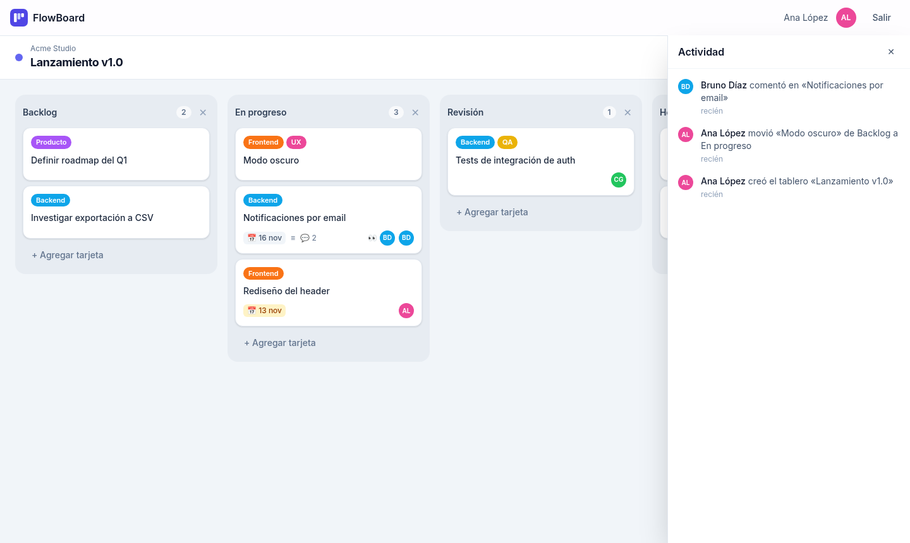

# FlowBoard · Kanban colaborativo en tiempo real

[](https://github.com/acostamatias220/flowboard/actions/workflows/ci.yml)


Gestor de proyectos estilo Kanban **fullstack** donde varios usuarios trabajan sobre el mismo tablero y ven los cambios de los demás **al instante**: mover tarjetas, editar, comentar y saber quién está conectado.

> 🇬🇧 _Realtime collaborative Kanban board built with React, Node.js/Express, PostgreSQL and Socket.IO. JWT auth with rotating refresh tokens, role based workspaces, drag & drop ordering persisted with fractional indexing, presence, activity log, tests, Docker and CI._



---

##  Funcionalidades

- **Autenticación segura**: registro / login con `bcrypt`, _access token_ JWT de vida corta y _refresh token_ opaco en cookie `httpOnly` con **rotación y detección de reutilización**.
- **Workspaces con roles** (`owner`, `admin`, `member`): invitación por email, cambio de roles y permisos aplicados en el backend.
- **Tableros, columnas y tarjetas** con **drag & drop** (`@dnd-kit`) para reordenar tarjetas y columnas; el orden se persiste en PostgreSQL.
- **Detalle de tarjeta**: descripción, responsable, etiquetas de colores, fecha de vencimiento (con aviso de vencida / próxima) y comentarios.
- **Tiempo real** con Socket.IO: los movimientos y ediciones se reflejan en todos los clientes conectados al tablero.
- **Presencia**: avatares de quién está en el tablero y de quién está mirando cada tarjeta.
- **Registro de actividad** por tablero (quién movió qué, de dónde a dónde).
- **Límite WIP** por columna (soportado en la API; la UI resalta la columna cuando se supera).
- **Seguridad**: validación con `zod`, manejo de errores centralizado, `helmet`, CORS restringido y _rate limiting_ (más estricto en endpoints de login).
- **Calidad**: tests de integración del backend contra PostgreSQL real, tests de componentes en el frontend, ESLint + Prettier y CI en GitHub Actions.

##  Stack

| Capa          | Tecnologías                                                                            |
| ------------- | -------------------------------------------------------------------------------------- |
| Frontend      | React 19, Vite, React Router, TanStack Query, Zustand, @dnd-kit, Tailwind CSS 4        |
| Backend       | Node.js, Express 5, Socket.IO, Knex (migraciones y seeds), zod, jsonwebtoken, bcryptjs |
| Base de datos | PostgreSQL                                                                             |
| Testing       | Vitest, Supertest, socket.io-client, Testing Library                                   |
| DevOps        | Docker, docker compose, Nginx (proxy de API + WebSocket), GitHub Actions               |

##  Arquitectura



**Principio clave:** todas las escrituras pasan por la API REST (validación, permisos y transacción en un solo lugar). Socket.IO solo **difunde** los cambios ya confirmados al _room_ del tablero.

### Flujo de un movimiento de tarjeta



### Modelo de datos



### Decisiones técnicas

- **Ordenamiento con _fractional indexing_**: cada columna/tarjeta tiene una `position` numérica. Mover un ítem calcula el punto medio entre sus nuevos vecinos, así que es **un único `UPDATE`** en lugar de renumerar toda la lista. Si el hueco se vuelve demasiado chico, se re-balancea la lista en la misma transacción.
- **Concurrencia**: las operaciones de orden toman un _lock_ de fila sobre el tablero (`SELECT … FOR UPDATE`), así dos usuarios arrastrando a la vez se serializan y nadie calcula posiciones sobre datos viejos.
- **Eventos después del commit**: los eventos de Socket.IO se emiten cuando la transacción se confirma, nunca por cambios que hicieron _rollback_.
- **Sin eco al autor**: el cliente envía su `X-Socket-Id`; el servidor excluye ese socket del broadcast porque ya aplicó el cambio de forma optimista.
- **Un único reducer** (`applyBoardEvent`) aplica tanto los cambios locales como los remotos sobre el cache de TanStack Query.
- **Refresh tokens**: opacos, guardados como hash SHA-256, con rotación en cada uso y revocación de toda la "familia" si se detecta reutilización (señal de robo).
- **Reconexión**: al reconectar el socket se vuelve a unir al tablero y se re-sincroniza el snapshot para recuperar eventos perdidos.

##  Estructura

```
kanban-realtime/
├── client/                 # React + Vite
│   └── src/
│       ├── components/     # UI compartida (Avatar, Modal, Toast…)
│       ├── features/       # auth · workspaces · board
│       ├── hooks/          # useBoard (query + socket), useBoardMutations
│       ├── lib/            # cliente HTTP con refresh automático, socket
│       ├── store/          # Zustand (sesión)
│       └── utils/          # reducer de eventos, ordenamiento, helpers
├── server/                 # Node + Express + Socket.IO
│   ├── src/
│   │   ├── config/         # validación de variables de entorno
│   │   ├── db/             # knex, migraciones, seeds
│   │   ├── middleware/     # auth, validate, errores, rate limit
│   │   ├── modules/        # auth · workspaces · boards · columns · cards
│   │   ├── realtime/       # socket server, presencia, emitter
│   │   ├── services/       # permisos, actividad, locks
│   │   └── utils/          # tokens, ordenamiento, AppError
│   └── tests/              # Vitest + Supertest + socket.io-client
├── docker-compose.yml
└── .github/workflows/ci.yml
```

##  Cómo correrlo

### Requisitos

- Node.js 20+ (recomendado 22)
- PostgreSQL 14+ (o Docker)

### Local

```bash
# 1. Instalar dependencias
npm run install:all

# 2. Crear la base de datos (ejemplo con psql)
createdb kanban
createdb kanban_test

# 3. Configurar variables de entorno del backend
cp server/.env.example server/.env
#   → completar DATABASE_URL, TEST_DATABASE_URL y JWT_ACCESS_SECRET

# 4. Migraciones + datos de ejemplo
npm --prefix server run db:migrate
npm --prefix server run db:seed

# 5. Levantar backend y frontend (en dos terminales)
npm run dev:server   # http://localhost:4000
npm run dev:client   # http://localhost:5173
```

El seed crea el workspace **Acme Studio** con un tablero de ejemplo y los usuarios `ana@demo.dev` (owner), `bruno@demo.dev` (admin) y `carla@demo.dev` (member). La contraseña es la de `SEED_USER_PASSWORD`; si la dejás vacía se genera una aleatoria y se muestra en la consola.

> Tip: abrí el tablero con dos usuarios en ventanas distintas (una en modo incógnito) para ver la sincronización y la presencia en vivo.

### Con Docker

```bash
cp .env.example .env          # completar POSTGRES_PASSWORD y JWT_ACCESS_SECRET
docker compose up --build
docker compose exec server node src/db/cli.js seed   # opcional: datos de ejemplo
```

- App: http://localhost:8080 (Nginx sirve la SPA y hace proxy de `/api` y `/socket.io`)
- API: http://localhost:4000/api/health

## 🧪 Tests

```bash
npm --prefix server test            # integración contra PostgreSQL (usa TEST_DATABASE_URL)
npm --prefix server run test:coverage
npm --prefix client test            # componentes + reducer
npm run lint                        # ESLint en ambos paquetes
npm run format:check                # Prettier
```

Los tests del backend cubren: registro/login, rotación y reutilización de refresh tokens, permisos por rol, CRUD de tarjetas, movimientos entre columnas, re-balanceo de posiciones, log de actividad y eventos de Socket.IO (presencia, broadcast sin eco, autenticación del handshake).

##  Variables de entorno

### `server/.env`

| Variable                 | Descripción                                                     | Ejemplo / default          |
| ------------------------ | --------------------------------------------------------------- | -------------------------- |
| `NODE_ENV`               | `development` \| `test` \| `production`                         | `development`              |
| `PORT`                   | Puerto HTTP de la API                                           | `4000`                     |
| `DATABASE_URL`           | Conexión a PostgreSQL                                           | `postgres://…/kanban`      |
| `TEST_DATABASE_URL`      | Base usada por los tests (se migra y se limpia en cada corrida) | `postgres://…/kanban_test` |
| `JWT_ACCESS_SECRET`      | Secreto para firmar access tokens (mín. 32 caracteres)          | —                          |
| `ACCESS_TOKEN_TTL`       | Vida del access token                                           | `15m`                      |
| `REFRESH_TOKEN_TTL_DAYS` | Vida del refresh token (días)                                   | `7`                        |
| `CLIENT_ORIGIN`          | Origen permitido por CORS y Socket.IO                           | `http://localhost:5173`    |
| `COOKIE_SECURE`          | `true` detrás de HTTPS (cookie con flag `Secure`)               | `false`                    |
| `SEED_USER_PASSWORD`     | Contraseña de los usuarios demo del seed                        | vacío → aleatoria          |

### `client/.env` (opcional)

| Variable            | Descripción                                        | Default                 |
| ------------------- | -------------------------------------------------- | ----------------------- |
| `VITE_API_URL`      | URL de la API si no se sirve desde el mismo origen | vacío (mismo origen)    |
| `VITE_PROXY_TARGET` | Destino del proxy de Vite en desarrollo            | `http://localhost:4000` |

### `.env` (raíz, para docker compose)

`POSTGRES_DB`, `POSTGRES_USER`, `POSTGRES_PASSWORD`, `JWT_ACCESS_SECRET`, `ACCESS_TOKEN_TTL`, `REFRESH_TOKEN_TTL_DAYS`, `SEED_USER_PASSWORD`.

> Ningún archivo `.env` se versiona: el repo solo incluye `.env.example` con valores vacíos.

##  API (resumen)

| Método | Endpoint                              | Descripción                          |
| ------ | ------------------------------------- | ------------------------------------ |
| POST   | `/api/auth/register` · `/login`       | Crea sesión (access token + cookie)  |
| POST   | `/api/auth/refresh` · `/logout`       | Rota / revoca el refresh token       |
| GET    | `/api/auth/me`                        | Usuario actual                       |
| GET    | `/api/workspaces` · `/:id`            | Workspaces del usuario / detalle     |
| POST   | `/api/workspaces/:id/members`         | Invitar miembro (admin+)             |
| PATCH  | `/api/workspaces/:id/members/:userId` | Cambiar rol (owner)                  |
| POST   | `/api/workspaces/:id/boards`          | Crear tablero                        |
| GET    | `/api/boards/:id`                     | Snapshot completo del tablero        |
| GET    | `/api/boards/:id/activity`            | Actividad paginada (`?limit&before`) |
| POST   | `/api/boards/:id/columns` · `/labels` | Crear columna / etiqueta             |
| PATCH  | `/api/columns/:id/move`               | Reordenar columna `{ index }`        |
| POST   | `/api/columns/:id/cards`              | Crear tarjeta                        |
| PATCH  | `/api/cards/:id`                      | Editar tarjeta                       |
| PATCH  | `/api/cards/:id/move`                 | Mover tarjeta `{ columnId, index }`  |
| POST   | `/api/cards/:id/comments`             | Comentar                             |

**Eventos de Socket.IO**: `board:join`, `board:leave`, `card:focus` (cliente → servidor) y `presence:update`, `card:created|updated|moved|deleted`, `column:created|updated|moved|deleted`, `comment:created|deleted`, `label:created|deleted`, `activity:created` (servidor → clientes).

##  Capturas

| Workspace y miembros                           | Detalle de tarjeta                          |
| ---------------------------------------------- | ------------------------------------------- |
|  |  |

| Registro de actividad en vivo                     |
| ------------------------------------------------- |
|  |

<!-- Podés agregar un GIF de dos navegadores sincronizados en docs/screenshots/realtime.gif -->

##  Próximos pasos

- Adapter de Redis para Socket.IO y presencia compartida (escalado horizontal).
- Notificaciones por email de tarjetas vencidas.
- Tests end-to-end con Playwright.

##  Licencia

MIT © Matías Acosta
